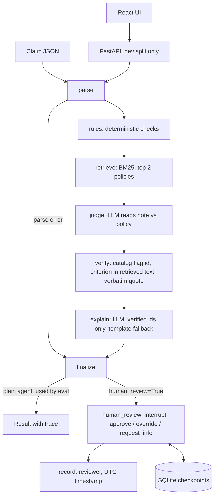

# Claims Review Agent

A prototype agent that reviews synthetic medical insurance claims for payment-integrity problems. Deterministic rules catch what code can check (invalid codes, unit limits, price outliers, duplicates, E/M level against diagnosis, laterality). An LLM (Groq `openai/gpt-oss-120b`, temperature 0) reads the clinical note against retrieved policy text only for the problems rules cannot see. Every flag must cite a policy criterion and, for LLM flags, a verbatim quote from the note; anything that fails verification is rejected and logged. The agent only recommends: a human reviewer can approve, override or ask for more information, and every action is recorded. All data, policies, price bands and limits are synthetic. Design decisions and incidents are logged in [DECISIONS.md](DECISIONS.md).

## What it does

The agent is a fixed LangGraph state machine with two validated LLM calls, not a free tool loop (D29).

1. **Parse.** Validate the claim into a typed object. A claim that cannot be parsed ends as `parse_error` with no LLM call.
2. **Rules.** Pure, typed rule functions raise rule flags, each with policy criterion evidence (D12, D17).
3. **Retrieve.** BM25 over the synthetic policies returns the top 2 whole policies, using a flag-aware query (D11, D21, D25).
4. **Judge.** The LLM reads the note and the retrieved policies and proposes policy-reading flags as JSON. One retry on a bad reply (D32).
5. **Verify.** A judged flag is kept only if its flag id is a policy-reading flag in the catalog, its criterion id is in the retrieved text and belongs to a policy linked to that flag, and its quote is a verbatim substring of the note (D31, D38). Rejections are kept in the result.
6. **Explain.** The LLM writes a short explanation that may cite only verified criterion ids and may not use decision words. One retry, then a deterministic template (D31, D34).
7. **Finalize.** Status, recommended action (`pass`, `flag` or `needs_human_review`), flags, rejections, explanation and a full trace. If the judge fails, rule flags are kept and the result is never `pass` (D32).
8. **Human review (opt-in).** The graph pauses with `interrupt()` after the agent result. The reviewer can approve, override (decision plus reason) or request info (question). Pauses persist in SQLite (`runs/checkpoints.sqlite`), one review per claim, and resuming makes no LLM call (D35 to D37).

## Architecture



## How to run

Python 3.12 in `.venv`, managed by uv (D9).

```bash
uv venv --python 3.12 .venv
```

```bash
uv pip install -r requirements.txt
```

Live LLM calls need a Groq key in the environment (see `.env.example`). Tests never need one.

```bash
export GROQ_API_KEY=your_key_here
```

Review one dev claim and print the full result with its trace:

```bash
.venv/bin/python scripts/review_claim.py --claim V2-0001 --split dev
```

Human review from the command line (`start` calls the LLM; `show` and `submit` do not):

```bash
.venv/bin/python scripts/human_review.py start --claim V2-0001 --split dev
```

```bash
.venv/bin/python scripts/human_review.py submit --claim V2-0001 --split dev --action approve --reviewer alex
```

API (dev split only, port 8000), from the repo root:

```bash
.venv/bin/uvicorn --factory --app-dir src claims_review.api:create_app
```

UI (React, Vite, TypeScript), then open http://localhost:5173:

```bash
cd ui && npm install && npm run dev
```

Tests (Python with a fake LLM, no network; UI with a mocked fetch):

```bash
.venv/bin/python -m pytest -q
```

```bash
cd ui && npm test && npm run typecheck
```

Rules-only baseline and dev evaluation (3 runs, writes `results/eval_dev.json`):

```bash
.venv/bin/python scripts/run_baseline.py --split dev
```

```bash
.venv/bin/python scripts/run_eval.py --split dev --runs 3
```

End-of-phase checks (no network, no LLM):

```bash
.venv/bin/python scripts/verify_phase.py
```

The test split is refused by every script without `--final`, and the final test run can happen only once (D14, D57).

## Data and privacy

All data is synthetic, produced by a seeded generator (D4, D7). ICD-10-CM codes are real public codes; CPT code numbers are real but every description is written in our own words; policies, price bands and unit limits are invented and labeled SYNTHETIC. No real patient or claim data is used anywhere.

Real claims would need PII and PHI redaction (names, member ids, dates of birth, free-text identifiers in notes) before any text reaches a model, plus a provider agreement that covers health data. This prototype does neither.

## Evaluation

**Method.** 60 synthetic claims split into 20 dev and 40 test. The test split and its ground truth are frozen by SHA256 in `data/v2/TEST_SPLIT.sha256` (D5). Tools, retrieval and prompts were tuned on dev only (D14). The eval runs the plain agent (no human review, D37). Dev used 3 runs, reported as the mean and the min to max range with every per-run number saved (D56). Test used 1 run (D65, D66), so it has no range and says nothing about run-to-run spread. The rules-only baseline is scored on the same claims with the same functions.

**Metrics** (D54, D55):

- **Decision accuracy.** A claim is Flagged when the agent recommends `flag`, Clear when it recommends `pass`, and Error when its status is not `ok` (`llm_failed`, `parse_error`, or an exception). An Error counts as wrong and is also reported as a count (D13).
- **Flag precision and recall.** Micro over (claim, flag id) pairs. An error claim raises no flags, so its expected flags count as misses. A zero denominator is reported as undefined, never 0.
- **policy_reading and rule subsets.** The same precision and recall restricted by the catalog's detection field. Rule flags share a catalog with the labels and are at ceiling by construction (D22), so the policy_reading subset is the one that measures what the LLM adds.
- **Also per run:** judge flags rejected by verification, LLM retries used, template-explanation fallbacks.

**Dev results** (`results/eval_dev.json`: 20 claims, 3 runs, `openai/gpt-oss-120b`, temperature 0, commit ff8eca4). These numbers are **optimistic**: the dev claims were used to build and tune the agent.

| Metric | Agent, mean (min to max) | Rules-only baseline |
|---|---|---|
| Decision accuracy | 0.983 (0.950 to 1.000) | 0.900 |
| Flag precision | 0.896 (0.889 to 0.900) | 1.000 |
| Flag recall | 0.963 (0.889 to 1.000) | 0.778 |
| policy_reading precision | 0.611 (0.500 to 0.667) | undefined (raises none) |
| policy_reading recall | 0.833 (0.500 to 1.000) | 0.000 |
| Rule precision | 1.000 (1.000 to 1.000) | 1.000 |
| Rule recall | 1.000 (1.000 to 1.000) | 1.000 |
| Errors | 0.33 (0 to 1) | 0 |
| Judge flags rejected | 0 (0 to 0) | n/a |
| Retries used | 1 (1 to 1) | n/a |
| Template fallbacks | 0 (0 to 0) | n/a |

What went wrong on dev: V2-0033 got a false positive `P_DEGENERATIVE_ONLY` in all 3 runs (see Limitations). In run 2, V2-0053 ended as an error, so its expected `P_NO_CONSERVATIVE_THERAPY` flag was missed. The baseline misses exactly the 2 policy-reading flags (V2-0009, V2-0053), as expected for a rules-only system.

### Test results

`results/eval_test.json`: 40 claims, 1 run, `openai/gpt-oss-120b`, temperature 0, commit dc229b5.

| Metric | Agent, single run | Rules-only baseline |
|---|---|---|
| Decision accuracy | 1.000 | 0.850 |
| Flag precision | 1.000 | 1.000 |
| Flag recall | 1.000 | 0.667 |
| policy_reading precision | 1.000 | undefined (raises none) |
| policy_reading recall | 1.000 | 0.000 |
| Rule precision | 1.000 | 1.000 |
| Rule recall | 1.000 | 1.000 |
| Errors | 0 | 0 |
| Judge flags rejected | 0 | n/a |
| Retries used | 2 | n/a |
| Template fallbacks | 0 | n/a |

What went wrong on test: for the agent, no missed flags, no false positives and no error claims. The baseline missed 6 policy-reading flags: `P_NO_CONSERVATIVE_THERAPY` on V2-0002, V2-0008 and V2-0048, and `P_DEGENERATIVE_ONLY` on V2-0010, V2-0045 and V2-0057.

- This is the one-time final run on the frozen split (D57), and the numbers are reported as they came out.
- It used 1 run because the free tier's limit of 200K tokens per day blocked 3 runs and Developer upgrades were unavailable (D65, D66). That 3 runs would not fit in one day is an estimate, not a measurement.
- The first launch was invalid (D63), and a second launch was stopped by the failure guard partway through run 1 with no file written (I59). Both are described under Honest notes. Neither was used, and agent logic did not change between them and this run.
- V2-0007, V2-0011 and V2-0031 are test claims that were inspected earlier (I30), so the test split was not completely unseen.

Compared with dev, the test scores are higher than the dev means, but with one run, 40 synthetic claims from the same generator and author, and only 6 expected policy_reading flags, that does not show the dev failures (V2-0033, V2-0053) are fixed or that the agent would do this well on real claims.

## Limitations

- **Shared catalog, single author.** Rules and labels derive from one flag catalog, and the labels were written by a single author (D23). Rule scores show consistency with the catalog, not real-world accuracy (D22).
- **Rule limits** (D24): laterality evidence accepts any diagnosis that names a side regardless of body site; the E/M level check silently passes when no diagnosis is in the tier table; one CPT per claim (D16); policy criteria must be one line each; the POL-002.4 citation uses tier 1 as a stand-in for "routine or minor illness" (D27).
- **V2-0031 evidence mismatch** (D28): the label cites POL-007.2, while the rule checks only the unit limit and cites POL-005.1 and POL-007.3.
- **Three test claims were inspected.** V2-0007, V2-0011 and V2-0031 (test split) were printed during a rule fix (I30). The rule change came from the policy text, not from any metric.
- **Verification proves grounding, not correctness** (D38, D59). It checks that the quote is in the note and the criterion is in the retrieved policy, not that the quote supports the flag. Example: on V2-0033 the judge quoted "Right knee pain and swelling." to support a degenerative-only flag; the sentence is real, so verification passed it, but it does not support the flag.
- **Explanations may mention codes or numbers that are not in the evidence** (D38). There is no check for this.
- **Wording checks use a fixed word list.** Decision words (deny, approve, reject and their forms) are caught by a regex; paraphrases are not.
- **Policy text names an internal file.** Two synthetic criteria (POL-002.2, POL-005.1) refer the reader to `data/v2/flag_catalog.json`, which a real policy would not do.
- **Prompt injection.** A clinical note could contain instructions that suppress a policy-reading flag (D38).
- **No authentication.** The reviewer name is free text (D46, D52).
- **No locking.** Two simultaneous submits for the same claim are not serialized (D46).
- **Killed process.** A process killed mid-review leaves the thread "incomplete"; delete `runs/checkpoints.sqlite` and restart the API (D44).
- **Dev split only.** The API and UI serve dev claims only; test claims are unreachable through them (D41, D52).
- **Unchecked API responses in the UI.** `ui/src/api.ts` casts response bodies to their TypeScript types without runtime validation.
- **Malformed JSON.** The model sometimes returns malformed JSON; the one retry usually recovers (I37).
- **Error claims raise no flags.** An `llm_failed` claim's rule flags are not credited in the metrics (D58).
- **Small policy-reading sample.** Dev has only 2 expected policy_reading flags, so the policy_reading scores move in large steps.
- **The verifier rejected nothing on dev.** 0 judge flags were rejected across 60 dev claim reviews (20 claims, 3 runs), so the rejection path is exercised only by unit tests.

## Honest notes

- **The first final test attempt was invalid.** Runs 2 and 3 of that attempt ended `llm_failed` (run 2 from V2-0004 onward, run 3 entirely); run 1 completed. The file is kept as `results/eval_test_attempt1_invalid.json` and was never opened or analyzed (D63). The likely cause is the provider's daily token limit: a later re-run was stopped by the failure guard with a tokens-per-day limit error (I59). An aborted launch writes no file and does not count as an attempt. The harness now records failure text and aborts after 3 consecutive failed claims without writing any results file (D64).
- Headline numbers are never the best of several runs (I1, D56).
- Every decision, deviation and mistake (including the reviewer's) is logged in [DECISIONS.md](DECISIONS.md).
